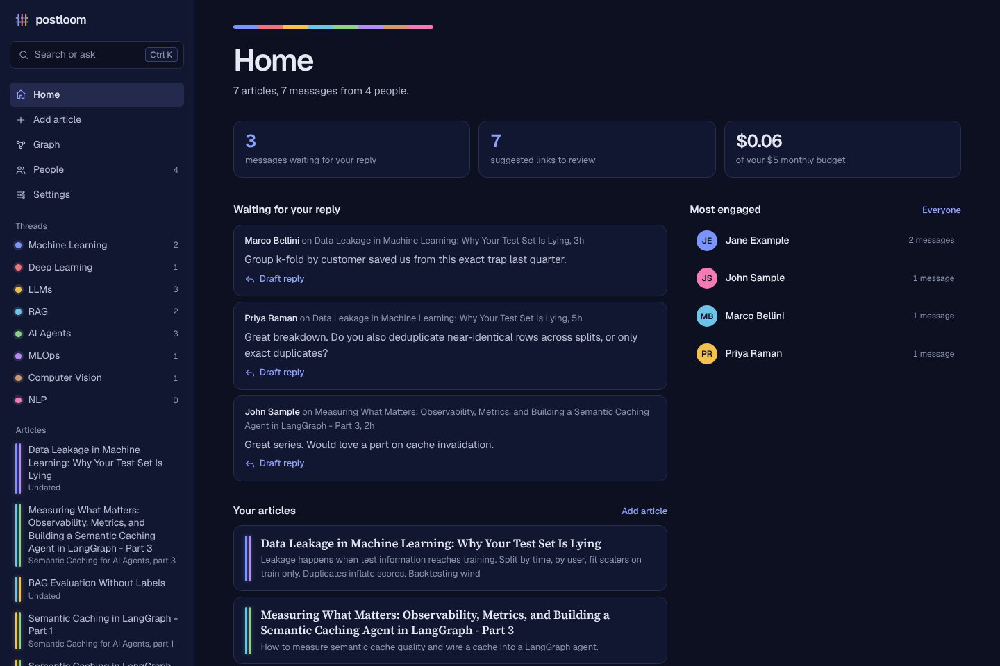
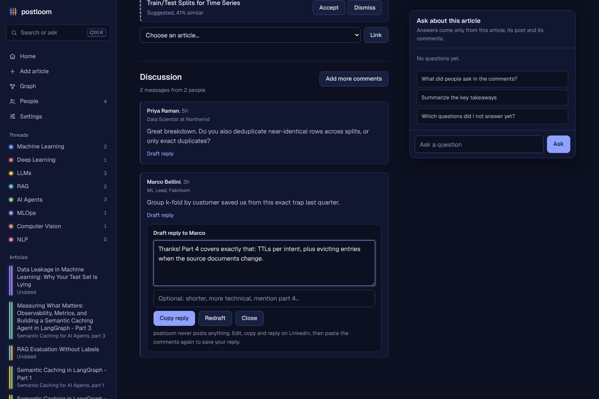
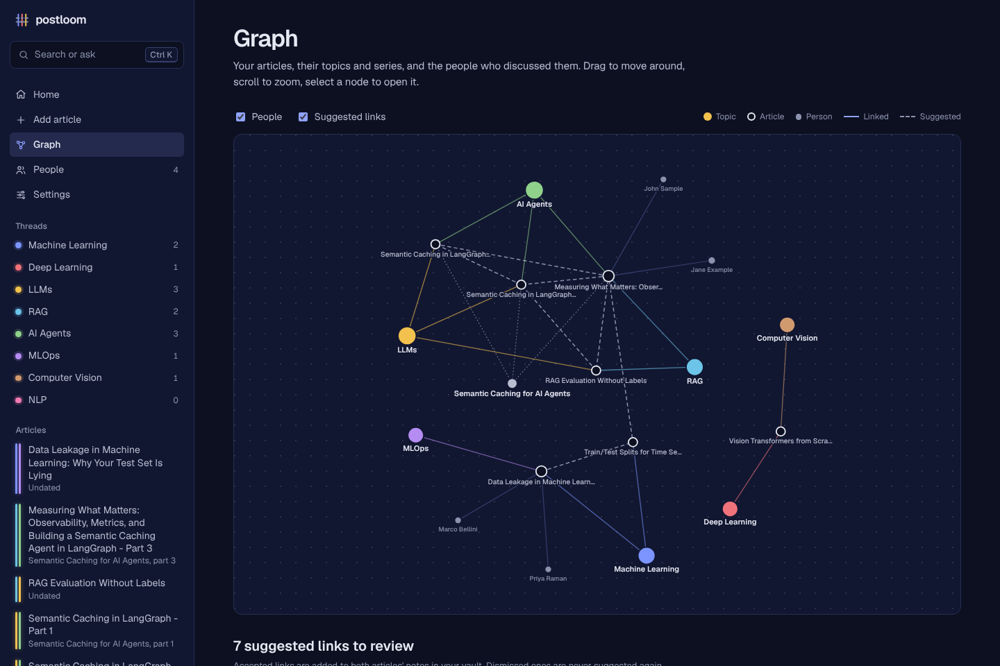

# postloom

**A local-first knowledge graph and chat for your LinkedIn articles, posts, comments and the people behind them.**

You publish an article, announce it in a post, and a conversation starts in the comments.
A week later it's all buried in the feed. postloom keeps it: paste in your article and post,
and it becomes a connected note in your own graph, linked to its topics, its series, the
links and hashtags you used, and every comment and reply. Then you can chat with any article
and its discussion, see who engages with your work, and draft replies grounded in what you
actually wrote.

> **Status: alpha.** Articles, search, chat, comment threads, people, reply drafts, related
> article links and the graph view work end to end. See the [roadmap](#roadmap).



<p align="center">
  
  
</p>

*Screenshots use sample data; the people in them are invented.*

## Why postloom

- **Runs on your machine.** Your writing and the people you talk to stay on your computer.
  No account, no cloud, no telemetry.
- **Any model, your key.** Gemini, Claude, OpenAI, OpenRouter, any OpenAI-compatible
  server, or free local models with Ollama. Search runs on your computer for free. A usage
  page shows what every task costs, and an optional monthly budget caps it.
- **Your files, not a database you can't read.** Everything lives in a plain Markdown folder
  that is also a valid [Obsidian](https://obsidian.md) vault. It is the source of truth:
  edit a note and postloom reads the change; lose the index and postloom rebuilds itself
  from the folder. Backing up that one folder backs up everything.
- **A graph you can trust.** Links parsed from your content are marked *verified*; links an AI
  suggests stay *asserted* until you accept them. Nothing you decided is ever overwritten,
  and history is kept instead of deleted.
- **Answers you can check.** Chat answers only from your own articles, posts and comments,
  cites the passage behind every claim, and says "not found" instead of guessing.
- **Knows your audience.** Every commenter becomes a person in the graph, identified by their
  LinkedIn profile URL, with every article they've interacted with. Anyone can be removed
  completely when they ask.

## Quick start

With [uv](https://docs.astral.sh/uv/) installed, one command downloads and starts postloom:

```bash
uvx postloom start
```

To keep it installed (`postloom` then works in any terminal):

```bash
uv tool install postloom      # or: pipx install postloom
postloom start
uv tool upgrade postloom      # later, to update
```

Your data stays in `~/Postloom` whichever way you run it, and upgrading never touches it.
To work on postloom itself, clone the repository and run `uv sync` then
`uv run postloom start`.

`postloom start` opens the app in your browser (dark by default; switch to light at the
bottom of the sidebar). Press <kbd>⌘K</kbd> or <kbd>Ctrl K</kbd> anywhere to search your
articles and people, ask a question, or jump to a page. On first run:

1. Open **Settings**, pick a model provider, paste your API key and click **Test
   connection**. Keys are saved only in your Postloom folder. No key? Choose Ollama and
   run models on your own computer.
2. Click **Add article**, paste a LinkedIn article and the post that announced it.
   postloom restores the formatting, files it under your topics and indexes it.
3. Open the article to read it and ask questions about it, or use the search box to search
   and ask across everything you've written. Answers cite the sections they come from, and
   when nothing relevant exists postloom says so instead of guessing.

### Choosing a provider

| Provider | Key | Good for |
|---|---|---|
| Google Gemini | [aistudio.google.com](https://aistudio.google.com/apikey) | A free tier to start with |
| Anthropic Claude | [console.anthropic.com](https://console.anthropic.com/settings/keys) | Reply drafts that sound like you |
| OpenAI | [platform.openai.com](https://platform.openai.com/api-keys) | GPT models |
| OpenRouter | [openrouter.ai](https://openrouter.ai/keys) | One key for hundreds of models, exact cost per call |
| Ollama | none | Free and fully private; needs a capable computer |
| Other OpenAI-compatible | depends | LM Studio, Groq, Mistral, DeepSeek, Together, vLLM... |

Each task has its own model, with sensible defaults: a cheap model restores articles,
reads comments and answers questions, and a stronger one writes reply drafts. Change any
of them under **Models** in Settings.

**What it costs.** Rough figures at list prices on 2026-10-25 (the usage page shows your
real numbers):

| | Gemini (default models) | Claude (Haiku, Sonnet for replies) |
|---|---|---|
| Adding a 2,000-word article | ~$0.01 | ~$0.002 |
| A question about an article | ~$0.005 | under $0.001 |
| A reply draft | ~$0.006 | ~$0.02 |
| A month of daily articles, 5 questions and 2 replies a day | ~$1.40 | ~$1.40 |

Search, related-article suggestions, the graph and the people pages cost nothing: they
run on your computer. (On Intel Macs, where the local embedding runtime isn't available,
postloom uses your provider's embeddings for search instead, or keywords.) Nothing runs in the background; a model is only called when you
click something.

**Local models with Ollama.** Install [Ollama](https://ollama.com), pull a model
(`ollama pull <model>`), choose Ollama in Settings and click **Test connection** to pick
from your installed models. Reading comments and chat work well with mid-size models.
Restoring long articles needs a capable model (14B parameters or more, so 32 GB of memory
helps) and can take several minutes. postloom sizes Ollama's context for every request and
refuses, with a clear message, texts too long for the limit you set, instead of letting
them be silently cut off.

### Comments and replies

On an article's page, click **Add comments**, then paste the comment section of your
post. Open the post on LinkedIn, expand all comments and replies, select the whole
section and copy it. postloom splits it into messages and works out who is answering
whom, including long back-and-forths with one person. Before anything is saved you can
check each message, fix where a reply belongs, mark your own replies, and add people's
profile links so they're recognised next time. Pasting the same section again later only
adds the new messages. Set **Your name on LinkedIn** in Settings so your replies are
recognised automatically.

### Reply drafts

Every comment has a **Draft reply** button. postloom writes a reply in your voice from your
article, the whole conversation up to that message, what you know about the person
(their headline, your notes, your earlier exchanges on other articles) and a few of your
earlier replies as examples of your tone. Tell it how to change the next draft ("shorter",
"mention part 4") and click **Redraft**. postloom never posts anything: edit the draft,
copy it and reply on LinkedIn, then paste the comments again to save your real reply.

### People

**People** lists everyone who has commented on your posts, most engaged first. A person's
page shows their headline (and earlier ones), your private notes, and every conversation
you've had with them, grouped by article. Add someone's LinkedIn profile link once and
postloom merges their comments into one identity and recognises them on every future
post. Each person also gets a note in `vault/people/`, so they appear in Obsidian's graph.

A person's page has its own chat, limited to your notes about them and the conversations
you had: "What does Jane care about?", "Is there anything I haven't answered?".

**Delete this person**, at the bottom of their page, erases their profile, your notes and
every message they wrote, from postloom and from your vault. Use it when someone asks you
to remove their data. Conversations they took part in stay readable, and your own replies
stay as you wrote them.

### Asking questions

Press `Ctrl K` (or `/`) and ask. postloom answers only from your library and cites its
sources, so you can open the passage behind each claim:

- *"How do I know if my cache serves wrong answers?"* finds the passages by meaning.
- *"What did Jane ask me?"* looks Jane up and reads your conversations with her.
- *"Which articles are in the caching series?"* and *"How many articles have I written
  about RAG?"* are answered from the graph, not guessed from similar text.
- Follow-up questions keep their subject.

If nothing in your library matches, postloom says so without calling the model, so a
wrong question costs nothing. An answer that cites no source is marked as unverified.

### Fixing and organising

- **Edit details** on an article fixes its title, summary, topics, series, date and link.
  The article keeps its identity, comments and links when you retitle it.
- **Delete** removes an article with its post and comments.
- **Settings → Topics** adds, renames and removes topics. Renaming a topic to the name of
  another one merges them.
- Adding an article you already have updates it, even if its title changed. A different
  article that happens to have the same title is kept separately; nothing is replaced on
  the strength of a title.

### Related articles and the graph

When you add an article, postloom compares it by meaning with everything you've written
and suggests links to the closest ones. Each article page lists them under **Related
articles**: **Accept** keeps a link, **Dismiss** hides it for good, and you can link any
two articles by hand. Only links you accept are written to your vault (as `related:` in
the article note), so Obsidian's graph shows your decisions, not a model's guesses.

**Graph** (in the sidebar) shows your articles, topics, series and the people who
discussed them. Suggested links are dashed until you review them; the list under the
graph lets you go through them all at once. Hover a node to see its neighbours, click to
open it, drag to pan and scroll to zoom.

### Your vault

Your data lives in `~/Postloom` (change it with `--home` or `POSTLOOM_HOME`). The `vault`
folder inside is plain Markdown: open it in [Obsidian](https://obsidian.md) to browse your
articles as a graph.

The vault is the source of truth, and `index.db` next to it is only a fast copy:

- **Edit notes freely.** Change an article's text or title, its `topics` or `related`
  links, a person's notes or tags, or a comment. postloom notices the edit, shows a banner
  and reads it; topics and links you change in a note count as your decisions.
- **Lose the index, lose nothing.** Delete `index.db` (or move the vault to another
  computer) and postloom rebuilds everything on the next start, including which links
  you accepted or dismissed and when.
- **Nothing is guessed or destroyed.** A note postloom can't read (say, broken YAML) is
  named and your edits wait until it's fixed. Notes that no longer match anything are
  moved to `vault/.postloom/trash`, never deleted. Notes you create yourself are left
  alone.
- The hidden `vault/.postloom` folder holds `edges.jsonl`, a plain-text record of where
  each link came from. It travels with the vault.

To delete an article or a person, use the app: it removes every trace, which deleting a
single note can't.

### Command line

Everything the app does is also available from the terminal (in a clone of the repository,
put `uv run` in front):

```bash
postloom ingest article.txt post.txt --date 2026-10-12   # add an article
postloom search "how do I know if my cache serves wrong answers" --explain
postloom reindex                                         # after upgrading
postloom links --explain                                 # how similar your articles are
postloom usage                                           # this month's calls and cost
postloom sync                                            # read your vault again
postloom doctor                                          # check provider, models, search, vault
```

`doctor` makes one tiny real call with each model you configured (a fraction of a cent), so
a wrong model name or a key without credits shows up there and not while you add an article.

### Settings

Everything is set in the app. Environment variables win over saved settings, which is
handy for servers and scripts.

| Setting | Environment variable | Default |
|---|---|---|
| Data folder | `POSTLOOM_HOME` | `~/Postloom` |
| Provider | `POSTLOOM_PROVIDER` | chosen in the app |
| API key | `POSTLOOM_API_KEY`, or the provider's own (`GEMINI_API_KEY`, `ANTHROPIC_API_KEY`, `OPENAI_API_KEY`, `OPENROUTER_API_KEY`) | saved in the app |
| Server address (Ollama, custom) | `POSTLOOM_BASE_URL` | the provider's |
| Models per task | `POSTLOOM_EXTRACTION_MODEL`, `POSTLOOM_COMMENTS_MODEL`, `POSTLOOM_CHAT_MODEL`, `POSTLOOM_REPLY_MODEL` | the provider's defaults |
| Search embeddings | `POSTLOOM_EMBEDDINGS` (`local`, `provider` or `off`) | `local` |
| Local embedding model | `POSTLOOM_LOCAL_EMBEDDING_MODEL` | `BAAI/bge-small-en-v1.5` (for other languages: `sentence-transformers/paraphrase-multilingual-MiniLM-L12-v2`) |
| Minimum similarity for a meaning-based match | `POSTLOOM_MIN_SIMILARITY` | calibrated per embedding model |
| Similarity needed to suggest a related article | `POSTLOOM_RELATED_SIMILARITY` | calibrated per embedding model |
| Monthly budget in US dollars | `POSTLOOM_MONTHLY_BUDGET` | none |
| Largest context for Ollama models | `POSTLOOM_OLLAMA_CONTEXT` | `32768` tokens |
| Your name on LinkedIn (recognises your replies) | `POSTLOOM_OWNER_NAME` | set in the app |

Prices for models postloom doesn't know can be added to `config.json` as
`"prices": {"model-id": [input, output]}` in dollars per million tokens.

## How it works

```
paste article + post (+ banner)
  -> extraction (cheap LLM): clean Markdown, title, summary, topics, entities, series
  -> rules: hashtags, links, ids, post->article edge, "Part N"
  -> vault/*.md (source of truth)  +  graph index (nodes, edges, provenance)

edit a note in Obsidian, or lose index.db
  -> postloom reads the vault back -> the index matches the notes again

ask a question (about everything, one article or one person)
  -> people, topics and series named in it are looked up in the graph
  -> hybrid search (keywords + embeddings) over articles, posts and comments
  -> answer with citations, "not found" without a model call, or a reply draft you approve
```

See [ARCHITECTURE.md](ARCHITECTURE.md) for the design and the reasoning behind it.

## Roadmap

- [x] Domain model with provenance and superseded history
- [x] Ingest use case, Markdown/Obsidian vault, architecture tests
- [x] **Milestone 1 (MVP):** SQLite index, Gemini extraction and embeddings, hybrid
      search, local web app with paste-to-add, search and grounded chat
- [x] **Milestone 2:** comments, replies and people
  - [x] Paste a comment section, review, save as conversation chains; chat sees them
  - [x] People pages: who engaged with what, headline history, profile links, notes
  - [x] Reply drafts grounded in the article and the whole conversation
- [ ] **Milestone 3:** graph and links
  - [x] Related-article suggestions you accept or dismiss, or link by hand
  - [x] Graph view of articles, topics, series and people
  - [ ] Banner images in the graph and search
- [x] **Providers:** Gemini, Claude, OpenAI, OpenRouter, Ollama and any OpenAI-compatible
      server; free local embeddings; usage page and monthly budget
- [x] **Own your data:** the vault is read back (rebuild, Obsidian edits), stable article
      identity, edit and delete articles, erase a person, manage topics
- [x] **Grounded chat:** posts and comments searched, graph lookups for people, topics and
      series, follow-ups, per-person chat, unverified answers flagged
- [x] **Milestone 4:** one-command install (`uvx`/`pipx`), browser tests in CI, first release
- [ ] Docker image

## Contributing

Contributions are welcome. See [CONTRIBUTING.md](CONTRIBUTING.md).

## Privacy

postloom runs only on your computer and listens only on `127.0.0.1`, so nothing on your
network can reach it. It refuses requests that don't come from its own page, so other
websites you visit can't use it either. It stores the names, headlines and profile URLs of
people who comment on your posts, locally and only for your own use. If one of them asks
to be removed, **Delete this person** erases them from the app, its history, the search
index and your vault.

When you use a hosted model, the text a feature needs (the article you add, the comments
you paste, the passages behind an answer) is sent to that provider under its terms. Check
them: free tiers may use your data for training. Search embeddings run on your computer by
default, and with Ollama nothing leaves your computer at all.

postloom is not affiliated with or endorsed by LinkedIn.

## License

postloom is **fair source**, under the [Functional Source License 1.1](LICENSE.md)
(FSL-1.1-ALv2). You can read, run, modify and share the code for anything except offering
a competing commercial product or service. Using postloom for your own work, including
your business, is allowed. Each release becomes Apache-2.0 two years after it is
published. The postloom name and logo aren't covered by the license.
