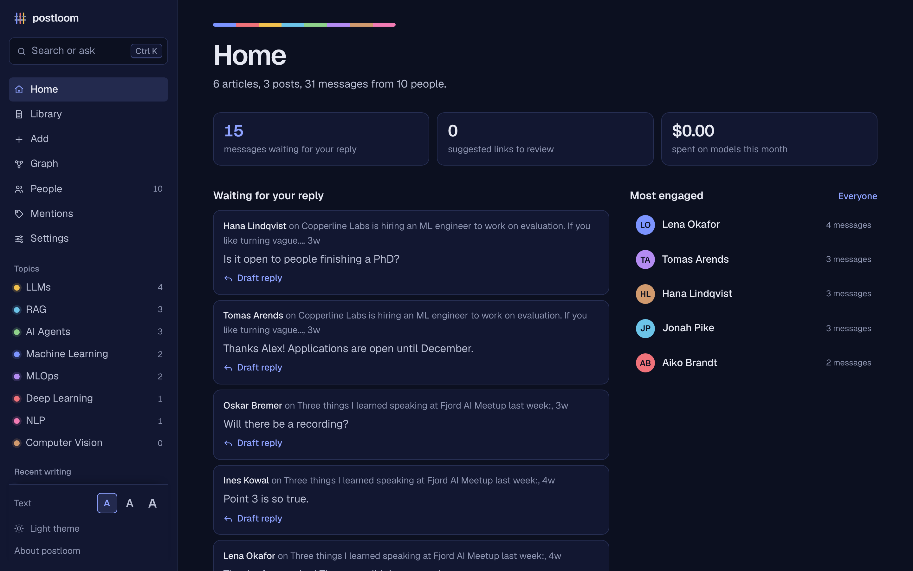
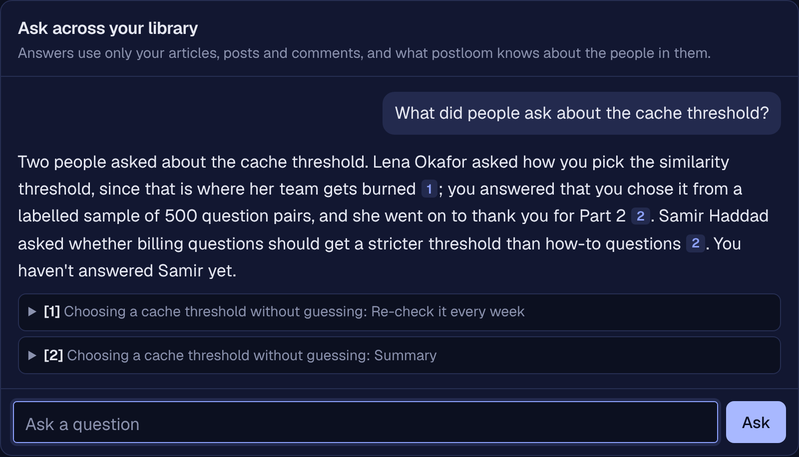

# postloom

**Your LinkedIn, remembered.** A private, local-first memory of your articles, posts, every
comment under them and the people who wrote them: search, chat, a knowledge graph and reply
drafts, with any AI model or none.

[](https://github.com/mdhabibi/postloom/actions/workflows/ci.yml)
[](https://pypi.org/project/postloom/)
[](https://pypi.org/project/postloom/)
[](LICENSE.md)

[Website](https://mdhabibi.github.io/postloom/) · [Install](#install) · [What's new](CHANGELOG.md)

You publish a post or an article, and a conversation starts in the comments. A week later
it's all buried in the feed. postloom keeps it: paste in your post or article, and it becomes
a connected note in your own graph, linked to its topics, its series, the links and hashtags
you used, and every comment and reply. Then you can chat with anything you wrote and its
discussion, see who engages with your work, and draft replies grounded in what you actually
wrote.



<p align="center">
  
  
</p>

*Screenshots use a fictional library: the author, the people and the numbers are invented.
`scripts/demo/screenshots.py` rebuilds it and retakes them.*

## Why postloom

- **Runs on your machine.** Your writing and the people you talk to stay on your computer.
  No account, no cloud, no telemetry.
- **Any model, your key.** Gemini, Claude, OpenAI, OpenRouter, any OpenAI-compatible
  server, or free local models with Ollama. Search runs on your computer for free. A usage
  page shows what every task costs, and an optional monthly budget caps it.
- **Your files, not a database you can't read.** Everything lives in a plain Markdown folder
  that is also a valid [Obsidian](https://obsidian.md) vault. It is the source of truth:
  edit a note and postloom reads the change; lose the index and postloom rebuilds itself
  from the folder. Backing up that one folder backs up everything.
- **A graph you can trust.** Links postloom reads from your own text are facts; links an AI
  suggests stay suggestions until you accept them. Nothing you decided is ever overwritten,
  and history is kept instead of deleted.
- **Answers you can check.** Chat answers only from your own articles, posts and comments,
  cites the passage behind every claim, and says "not found" instead of guessing.
- **Knows your audience.** Every commenter becomes a person in the graph, identified by their
  LinkedIn profile URL, with every article they've interacted with. Anyone can be removed
  completely when they ask.

## Install

You don't need Python or anything else first, and nothing needs administrator rights.
Copy one line, paste it, press Enter. The [website](https://mdhabibi.github.io/postloom/#install)
shows the same in four illustrated steps.

**Mac** (press <kbd>⌘ Space</kbd>, type *Terminal*, press Enter) or **Linux** (open a
terminal):

```bash
curl -LsSf https://raw.githubusercontent.com/mdhabibi/postloom/main/install.sh | sh
```

**Windows** (open the Start menu, type *PowerShell*, press Enter):

```powershell
irm https://raw.githubusercontent.com/mdhabibi/postloom/main/install.ps1 | iex
```

It takes a minute or two and opens postloom in your browser. From then on, open it from
the **Postloom** icon: Launchpad or Spotlight on a Mac, the Start menu or the desktop on
Windows, the applications menu on Linux. You won't need the terminal again.

- **Update:** run the same line again. Your data is never touched.
- **Stop:** choose **Quit postloom** at the bottom of the sidebar.
- **Uninstall:** run the line below for your computer. Your data folder is kept; delete it
  yourself if you want.

```bash
curl -LsSf https://raw.githubusercontent.com/mdhabibi/postloom/main/install.sh | sh -s -- --uninstall
```

```powershell
$env:POSTLOOM_UNINSTALL = 1; irm https://raw.githubusercontent.com/mdhabibi/postloom/main/install.ps1 | iex
```

The installer uses [uv](https://docs.astral.sh/uv/), which downloads its own copy of Python
for postloom, so it never changes the Python on your computer. Everything else postloom
needs (its database, search engine and local search model) is inside it or downloaded on
first use: there is no database server to install.

**For developers:** `uvx postloom start` runs it from PyPI, `uv tool install postloom` keeps
it installed, and `uv sync && uv run postloom start` runs a clone.

## Getting started

postloom opens in your browser (dark by default; switch to light at the bottom of the
sidebar). Press <kbd>⌘K</kbd> or <kbd>Ctrl K</kbd> anywhere to search your
articles and people, ask a question, or jump to a page. On first run:

1. Open **Settings**, pick a model provider, paste your API key and click **Test
   connection**. Keys are saved only in your Postloom folder. No key? Choose **Ollama**:
   postloom walks you through installing it, suggests a model that fits your computer's
   memory and downloads it, all without a terminal.
2. Click **Add**. For an article, paste it and the post that announced it; postloom
   restores the formatting, files it under your topics and indexes it. For a post that
   stands on its own, choose **Post** and paste it (no model needed; with one, postloom
   also picks its topics).
3. Open the article to read it and ask questions about it, or use the search box to search
   and ask across everything you've written. Answers cite the sections they come from, and
   when nothing relevant exists postloom says so instead of guessing.

## Choosing a model

| Provider | Key | Good for |
|---|---|---|
| Google Gemini | [aistudio.google.com](https://aistudio.google.com/apikey) | A free tier to start with |
| Anthropic Claude | [console.anthropic.com](https://console.anthropic.com/settings/keys) | Reply drafts that sound like you |
| OpenAI | [platform.openai.com](https://platform.openai.com/api-keys) | GPT models |
| OpenRouter | [openrouter.ai](https://openrouter.ai/keys) | One key for hundreds of models, exact cost per call |
| Ollama | none | Free and fully private; needs a capable computer |
| Other OpenAI-compatible | depends | LM Studio, Groq, Mistral, DeepSeek, Together, vLLM... |

Each task has its own model, with sensible defaults: a cheap model restores articles,
reads comments and answers questions, and a stronger one writes reply drafts. Change any
of them under **Models** in Settings.

**What it costs.** Rough figures at list prices on 2026-10-25 (the usage page shows your
real numbers):

| | Gemini (default models) | Claude (Haiku, Sonnet for replies) |
|---|---|---|
| Adding a 2,000-word article | ~$0.01 | ~$0.002 |
| A question about an article | ~$0.005 | under $0.001 |
| A reply draft | ~$0.006 | ~$0.02 |
| A month of daily articles, 5 questions and 2 replies a day | ~$1.40 | ~$1.40 |

Search, related-article suggestions, the graph and the people pages cost nothing: they
run on your computer. (On Intel Macs, where the local embedding runtime isn't available,
postloom uses your provider's embeddings for search instead, or keywords.) Nothing runs in
the background; a model is only called when you click something.

**Local models with Ollama.** Choose Ollama in Settings. postloom checks whether
[Ollama](https://ollama.com) is installed and running (and starts it for you), suggests a
model for your computer's memory (Qwen 3.5 in 4B, 9B or 27B), downloads it with a progress
bar and uses it for every task. Models you already pulled are offered too. Reading
comments and chat work well with mid-size models. Restoring long articles needs a capable
model (14B parameters or more, so 32 GB of memory helps) and can take several minutes.
postloom sizes Ollama's context for every request and refuses, with a clear message, texts
too long for the limit you set, instead of letting them be silently cut off.

## What you can do

- **Comments and replies:** paste a comment section; postloom works out who answered whom,
  and drafts replies in your voice from the article and the whole thread.
- **People:** everyone who engaged with you, across all your posts, with your private notes.
- **Mentions:** the people, organisations, events and links your writing names, confirmed
  by you before they enter your graph.
- **Images and videos:** found by your captions, by what a model sees in them and by
  subtitles.
- **Ask questions:** answers only from your own library, with sources you can open.
- **The graph:** articles, topics, series, people and mentions, focused on whatever you pick.
- **Your vault:** plain Markdown you can open in Obsidian, edit, back up or move.
- **Command line:** everything the app does, scriptable.

The [user guide](docs/guide.md) explains each of them in detail, with every setting.

## Privacy

postloom runs only on your computer and listens only on `127.0.0.1`, so nothing on your
network can reach it. It refuses requests that don't come from its own page, so other
websites you visit can't use it either. It stores the names, headlines and profile URLs of
people who comment on your posts, locally and only for your own use. If one of them asks
to be removed, **Delete this person** erases them from the app, its history, the search
index and your vault.

When you use a hosted model, the text a feature needs (the article you add, the comments
you paste, the passages behind an answer, an image you ask it to describe) is sent to that
provider under its terms. Check them: free tiers may use your data for training. Search
embeddings run on your computer by default, and with Ollama nothing leaves your computer
at all.

postloom is not affiliated with or endorsed by LinkedIn.

## Documentation

- [User guide](docs/guide.md): every feature and setting
- [Architecture](ARCHITECTURE.md): how postloom is built, and why
- [Changelog](CHANGELOG.md): what changed in each version
- [Contributing](CONTRIBUTING.md), [code of conduct](CODE_OF_CONDUCT.md) and
  [security policy](SECURITY.md)

## Roadmap

postloom 0.1.0 is the first public release. Next:

- Double-click installers for Mac and Windows, signed so no security warning appears
  ([#23](https://github.com/mdhabibi/postloom/issues/23))
- A Docker image, for running postloom on a home server

Something missing? [Suggest an idea](https://github.com/mdhabibi/postloom/issues/new?template=idea.yml).

## Contributing

Contributions are welcome. See [CONTRIBUTING.md](CONTRIBUTING.md).

## License

postloom is **fair source**, under the [Functional Source License 1.1](LICENSE.md)
(FSL-1.1-ALv2). You can read, run, modify and share the code for anything except offering
a competing commercial product or service. Using postloom for your own work, including
your business, is allowed. Each release becomes Apache-2.0 two years after it is
published. The postloom name and logo aren't covered by the license.
